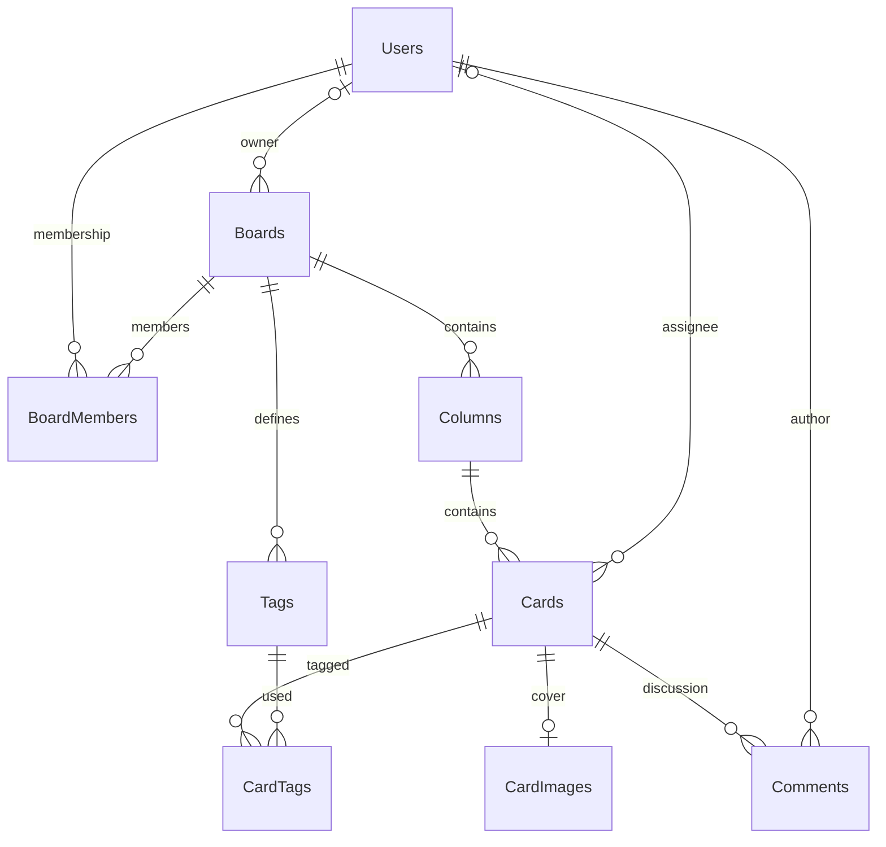

# KanbanBoard — матеріали для захисту

Дата: 16.10.2026. Джерела: [вимоги](REQUIREMENTS.md), [архітектура й контракти](IMPLEMENTATION.md), [розширення PH-08](PH08_DESKTOP.md), [фактичні екрани](screenshots/ph08/README.md).

## Архітектура та модель даних

Нативний Avalonia-клієнт працює через HTTP API та JWT. ASP.NET Core перевіряє актуальне членство і дозволи, виконує транзакції EF Core в MSSQL 2022. API і БД запускаються Compose; дані та зображення зберігаються у SQL volume. Клієнт не має SQL connection string.



Залишаються дев’ять предметних таблиць. Аватар, версія сесії та rowversion додані до Users; обкладинка, власник і архів — до Boards; обране/останні — до BoardMembers; архів — до Cards; версія й дата редагування — до Comments. Друга міграція зберігає початкові записи й визначає власника наявних дощок. Призначення відповідального перевіряється також за членством у конкретній дошці.

## Приклади API

У прикладах `<...>` — значення з попереднього GET або відповіді створення. Версії — Base64 значення rowversion, ідентифікатори — UUID. Заголовок захищеного запиту: `Authorization: Bearer <access-token>`. Повний [перелік базових маршрутів](IMPLEMENTATION.md#4-контракт-api) і [розширень PH-08](PH08_DESKTOP.md#api-розширення).

Створення картки — `POST /api/boards/{boardId}/cards`:

```json
{
  "columnId": "<column-id>",
  "title": "Перевірити обкладинки",
  "description": "Фото на дошці та повний перегляд у редакторі",
  "dueDate": "2026-10-20",
  "priority": "High",
  "assigneeId": "<current-member-id>",
  "tagIds": ["<board-tag-id>"],
  "expectedBoardVersion": "<board-version>"
}
```

Переміщення — `POST /api/cards/{cardId}/move`:

```json
{
  "targetColumnId": "<target-column-id>",
  "beforeCardId": null,
  "expectedBoardVersion": "<board-version>",
  "expectedVersion": "<card-version>"
}
```

`beforeCardId = null` додає картку в кінець. Сервер під блокуванням дошки перевіряє права та версії, перебудовує щільні позиції й повертає нові версії. Застарілий запис отримує `409 concurrency_conflict`; клієнт показує конфлікт і зберігає чернетку. При мережевій помилці оптимістичне переміщення відкочується.

Профіль — `PUT /api/profile`:

```json
{
  "name": "Олена Мельник",
  "email": "olena@example.test",
  "currentPassword": "<current-password-if-email-changed>",
  "expectedVersion": "<user-version>"
}
```

Зміна пароля використовує `PUT /api/profile/password`: CurrentPassword, NewPassword, ConfirmPassword і ExpectedVersion. Новий JWT містить оновлену версію сесії; попередні токени відхиляються. Для фото картки `PUT /api/cards/{id}/image` приймає multipart `File`, `ExpectedBoardVersion`, `ExpectedVersion`; для дошки потрібні `File` і `ExpectedBoardVersion`, для аватара — `File` і `ExpectedVersion`.

## Сценарій демонстрації

1. [Запустити Compose і нативний клієнт](DEPLOYMENT.md); за потреби виконати `scripts/seed-demo.py`. Дані входу демонстраційних аккаунтів залишаються в локальному TestResults.
2. Увійти, показати шість плиток, обкладинки, ролі/учасників і пошук. Створити дошку, додати колонки, відкрити налаштування.
3. Запросити вже зареєстрованого учасника, змінити роль і два дозволи. Показати захищеного власника, скасування та збереження.
4. Створити картку: усі поля, календар, відповідальний, кольоровий тег. Після збереження додати фото й коментар; відкрити повний розмір, меню коментаря.
5. Перетягнути картку між колонками й усередині колонки; переставити колонку. У другому аккаунті показати спільне оновлення.
6. Поєднати пошук, пріоритет, тег, відповідального й дедлайн. Скинути. Архівувати й відновити картку та дошку; показати обране, особисті задачі й команду.
7. Відкрити власний профіль, змінити ім’я/аватар, показати поля зміни email і пароля. Вийти: приватний вміст і JWT з пам’яті очищуються.
8. Показати протоколи тестів, навантаження та перезапуску. Не виконувати руйнівні дії над чужими робочими даними під час демонстрації.

## Докази та межі вимірювання

| Перевірка | Фактичний результат |
| --- | --- |
| Release | 0 помилок, 0 попереджень |
| Автоматизовані перевірки | [105 виконано, 105 пройдено, 0 пропусків](PH08_TEST_RESULTS.json); реальна MSSQL, міграції, API й клієнтські сценарії |
| 20 користувачів | [442 стандартні запити](PH08_LOAD_RESULTS.json), максимум 488,227 мс, p95 340,738 мс |
| Конкурентний запис | 1 прийнятий, 19 конфліктів 409; цілісність збережена |
| Перезапуск API і SQL | [Точний збіг знімків даних і 10 медіаресурсів](PH08_PERSISTENCE_RESULTS.json); 10 карток, 4 колонки, 4 учасники |
| Живий Avalonia | [Галерея](screenshots/ph08/README.md): справжні екрани, два користувачі, drag-and-drop, комбіновані фільтри, архів і профіль |

Це локальний стенд Apple Silicon з емуляцією SQL linux/amd64. Навантаження вимірює серверні HTTP-операції; створення аккаунтів і послідовний вхід наведені окремо. Воно не вимірює FPS чи повний рендер клієнта. Плавність перетягування перевірена взаємодією у вікні; показник обробника з PH-05 не підміняє вимірювання кадрів. Офлайн-синхронізація, LAN і хмарний деплой не входять до погодженого обсягу.
