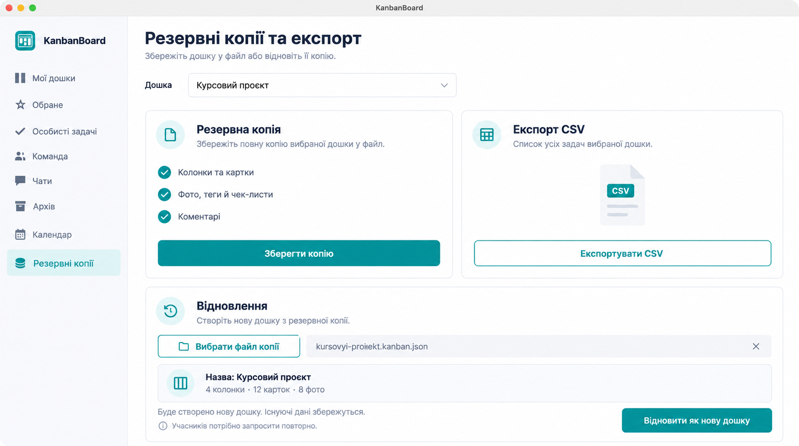

# Резервна копія дошки та CSV — концепт 21.10.2026

Макет резервного копіювання, відновлення та експорту задач. Візуальний орієнтир — [дошка з чек-листами](../screenshots/checklists/02-board.png). Макет описує компонування; результати роботи застосунку наведено у [звіті PH-09](../PH09_BACKUPS.md).

Копія вибраної дошки містить колонки, картки, фото, теги, чек-листи й коментарі. Відновлення створює **нову** дошку; існуючі дані не перезаписуються. Учасники запрошуються знову; імена історичних авторів і виконавців зберігаються як відомості з копії без надання доступу від їхнього імені. CSV містить список задач.
