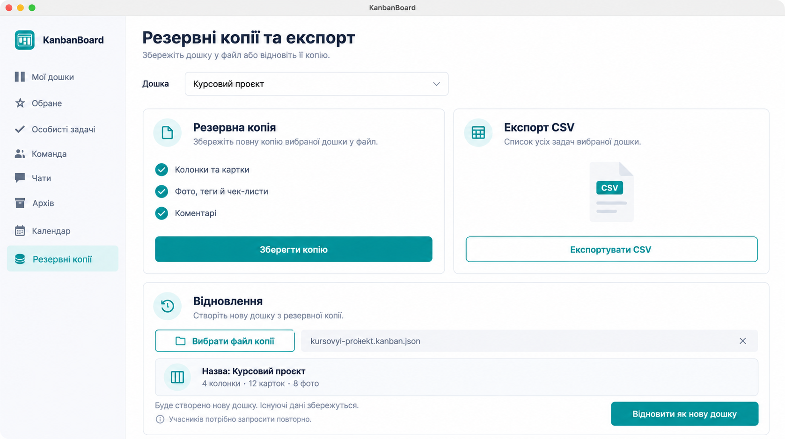

# Резервна копія дошки та CSV — концепт 21.10.2026

Створено до коду вбудованим image_gen через навичку imagegen; референс — `screenshots/checklists/02-board.png`. Макет, не runtime-доказ.

Погоджено: копія вибраної дошки (колонки, картки, фото, теги, чек-листи, коментарі); відновлення створює **нову** дошку. Існуючі дані не перезаписуються. Учасники запрошуються знову; імена історичних авторів/виконавців зберігаються як відомості з копії без видавання себе за іншого користувача. CSV містить список задач.

## Prompt (built-in)

Use case: ui-mockup. Generate ONE coherent polished native macOS Avalonia KanbanBoard desktop UI concept for board backup, restore and CSV export, using supplied real application screenshot only as visual reference. Preserve actual teal logo, pale sidebar, dark navy text, white panels, teal controls, subtle borders and round corners. Ukrainian UI. Sidebar current Мої дошки, Обране, Особисті задачі, Команда, Чати, Архів, Календар, selected Резервні копії. Main title Резервні копії та експорт. Subtitle Збережіть дошку у файл або відновіть її копію. A board dropdown labeled Дошка with Курсовий проєкт selected. Below two clean side by side sections. Left Резервна копія with concise list Колонки та картки; Фото, теги й чек-листи; Коментарі and teal button Зберегти копію. Right Експорт CSV with caption Список усіх задач вибраної дошки and outlined teal button Експортувати CSV. A large third lower section Відновлення with outlined button Вибрати файл копії, selected filename kursovyi-proiekt.kanban.json, preview Назва: Курсовий проєкт / 4 колонки · 12 карток · 8 фото and explanation Буде створено нову дошку. Існуючі дані збережуться. At bottom right teal Відновити як нову дошку. Small muted note Учасників потрібно запросити повторно. No passwords, no database administration, no cloud storage or scheduling, no unrelated UI features, no browser chrome, no watermark. This is a generated design concept not a runtime screenshot.
