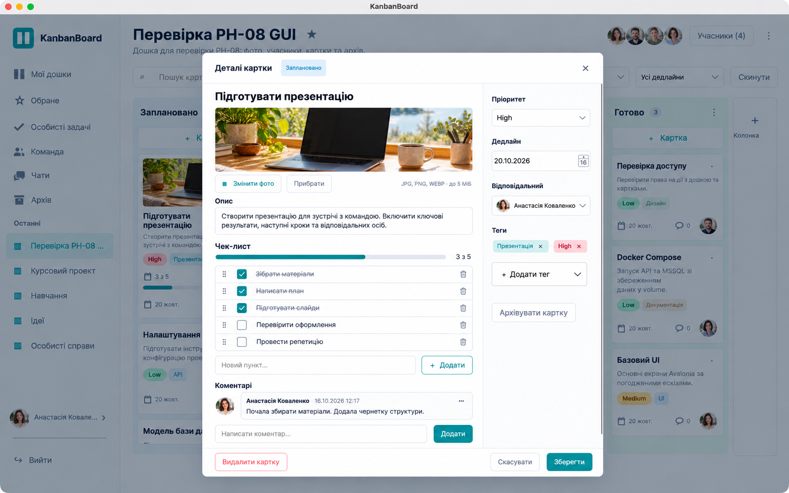

# Концепт чек-листів — 19.10.2026

Згенеровано вбудованим image_gen через навичку imagegen **до реалізації коду**, як попросив користувач. Це концепт, а не скриншот працюючого застосунку. Візуальні референси — `docs/screenshots/ph08/02-card-details.png` і `04-board.png`. Фінальний вибраний оригінал збережений у репозиторії без змін.

Робочі рішення: один упорядкований чек-лист на картку; прапорці, редагування, додавання, видалення, перетягування й кнопки перестановки; прогрес у редакторі й на дошці. Зміни — чернетка до спільної кнопки «Зберегти»; скасування не змінює БД. Сповіщення та WIP-ліміти не входять у погоджений обсяг.

## Фінальний запит до генератора (built-in)

Use case: ui-mockup. Create a high-fidelity generated visual concept for a NEW CHECKLIST feature in the EXISTING KanbanBoard native macOS desktop application. The two attached images are STYLE AND LAYOUT REFERENCES ONLY, not edit targets. Faithfully retain the actual application's white/light gray surfaces, teal #168C98 controls, dark navy Inter-like typography, restrained rounded borders and existing Ukrainian labels. Show ONE coherent 16:10 desktop screenshot with a large card detail modal centered over the dimmed four-column board. The modal title is 'Деталі картки', editable card title 'Підготувати презентацію'. Keep left main content and right sidebar with 'Пріоритет', 'Дедлайн', 'Відповідальний', 'Теги', and bottom 'Скасувати' / teal 'Зберегти'. Keep an attractive modest photo cover of a laptop on desk but shrink its height to fit checklist. Between 'Опис' and 'Коментарі', add a polished section titled 'Чек-лист' with a compact '3 з 5' count on the right and a thin teal progress bar filled exactly 60%. Exactly FIVE rows: three checked teal square checkboxes with subtle struck-through text 'Зібрати матеріали', 'Написати план', 'Підготувати слайди'; two unchecked rows 'Перевірити оформлення', 'Провести репетицію'. Each row has a discreet six-dot drag handle on left, checkbox, editable label, and a small delete icon on right. Under the rows an outlined input placeholder 'Новий пункт…' and button '+ Додати'. Place one unobtrusive comment preview below. In the visible board background, make one relevant card have a small checklist icon with a '3 з 5' pill and 60% mini progress bar, so both board overview and details checklist are shown in the same concept. All text Ukrainian with correct spelling, clear legibility, plausible functional controls, generous spacing. Keep existing sidebar layout and logo direction, including 'Мої дошки', 'Обране', 'Особисті задачі', 'Команда', 'Чати', 'Архів'. No made-up extra features, no marketing slogans, no collage, no arrows or explanatory annotations, no watermarks. This is a design concept, not proof of implemented software.
