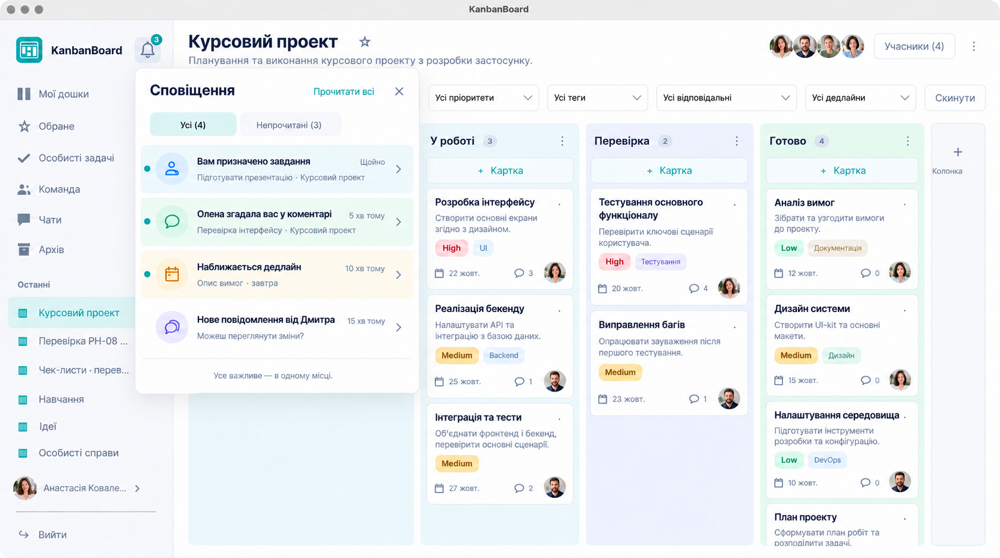
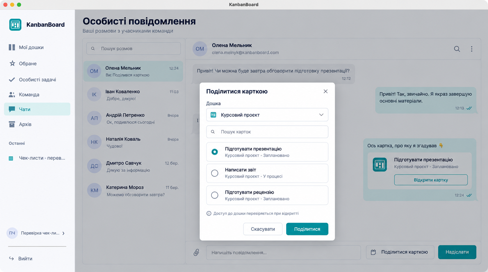

# Концепти сповіщень і карток у чаті — 19.10.2026

Обидва концепти створені **до коду** вбудованим image_gen через навичку imagegen. Це згенеровані зображення, не докази роботи програми. Референси: актуальні скриншоти `screenshots/ph08/04-board.png` і `screenshots/checklists/02-board.png`; макет чату узгоджений зі структурою наявного `ChatView`.

Реалізація: глобальний дзвіночок, кількість непрочитаних, усі/непрочитані, прочитати всі, події призначення/згадки/дедлайну/повідомлення, перехід із перевіркою доступу. Згадка — @email учасника з вибором із наявного списку; дедлайн — сьогодні/завтра для призначених користувачу карток. Лічильник відображає фактичні непрочитані. Текст футера концепту декоративний.

Наступний погоджений етап: кнопка «Поділитися карткою», вибір власної доступної дошки та картки, повідомлення з посиланням, відкриття лише за чинного доступу до дошки. Декоративні пошук розмов, скріпка та подвійні позначки генерації не розширюють обсяг запиту.

## Запит генерації центру (built-in)

Use case: ui-mockup. Generate ONE polished desktop UI concept for the notification center of the EXISTING KanbanBoard native Avalonia macOS app, using the two supplied screenshots as style/layout REFERENCES ONLY, not edit targets. Retain the current app logo direction from reference 2, white surfaces, very light blue-gray sidebar, dark navy typography, teal #168C98 accent, subtle borders and rounded controls. Show a realistic four-column board titled 'Курсовий проєкт', with cards and checklist progress in the background. Retain sidebar navigation 'Мої дошки', 'Обране', 'Особисті задачі', 'Команда', 'Чати', 'Архів', and profile/logout below. Add a simple outline bell button near the KanbanBoard branding in the left sidebar, with a small teal unread badge '4', so it is globally available on every page. The bell opens a beautiful white floating panel aligned beside the sidebar over the board, about 460px wide. Panel header 'Сповіщення', close ×, small teal action 'Прочитати всі', tabs 'Усі' / 'Непрочитані'. Show exactly four clear notification rows with compact pastel type icons, concise Ukrainian copy and muted context/time. Row1 assignment: 'Вам призначено завдання', context 'Підготувати презентацію · Курсовий проєкт', time 'Щойно'. Row2 comment mention: 'Олена згадала вас у коментарі', context 'Перевірка інтерфейсу · Курсовий проєкт', time '5 хв тому'. Row3 deadline: 'Наближається дедлайн', context 'Опис вимог · завтра', time '10 хв тому'. Row4 message: 'Нове повідомлення від Дмитра', context 'Можеш переглянути зміни?', time '15 хв тому'. Unread rows have small teal dots and subtle tinted backgrounds. Each whole row clearly clickable with a discreet chevron; card events lead to card editor, message to personal chat, without showing extra screens or callout arrows. Footer understated 'Усе важливе — в одному місці'. Keep layout plausible, generous spacing, legible Ukrainian, restrained visual density. No unrelated features, no web UI chrome, no promotional graphics, no watermarks. This image is a design concept, not a runtime screenshot.

## Точкове уточнення лічильника (built-in edit)

Edit this notification-center concept only to make the unread counters consistent: change the small teal badge next to the sidebar bell from '4' to '3'. Keep 'Усі (4)' and 'Непрочитані (3)', three unread dots and the fourth message row already read. Preserve every other pixel of layout, colors, icons, logo, board, Ukrainian text, panels and proportions as closely as possible. Do not add or remove anything else.

## Запит генерації зв’язку чату з картками (built-in)

Use case: ui-mockup. Generate ONE high fidelity UI concept for 'share a task card in personal chat' in the EXISTING KanbanBoard Avalonia desktop macOS app. Supplied screenshot is a STYLE reference only. Preserve its real teal logo, white background, navy text, teal #168C98, subtle rounded borders and light gray left navigation including 'Мої дошки', 'Обране', 'Особисті задачі', 'Команда', 'Чати', 'Архів', profile/logout. Match the actual chat layout: page heading 'Особисті повідомлення', subtitle 'Ваші розмови з учасниками команди'; a white bordered content area split into a 280px conversation list and a roomy conversation with 'Олена Мельник' heading and muted email. Pale gray received bubbles on left, pale teal outgoing bubbles on right, each with small time. Bottom composer text input 'Напишіть повідомлення…' and teal 'Надіслати', with an understated adjacent button 'Поділитися карткою'. In the visible conversation show an elegant shared task tile inside an outgoing bubble: teal board icon, card title 'Підготувати презентацію', secondary 'Курсовий проєкт · Заплановано', and outlined teal action 'Відкрити картку'. Also show a centered compact white modal titled 'Поділитися карткою', with a board dropdown 'Курсовий проєкт', search field 'Пошук карток', three selectable task rows including the selected 'Підготувати презентацію', and bottom buttons 'Скасувати' / teal 'Поділитися'. Under the selection a single subtle note 'Доступ до дошки перевіряється при відкритті'. The modal lightly dims the chat but leaves the shared tile and composer recognizable. This is one coherent realistic screenshot, no collage or arrows. Every Ukrainian label correctly spelled and legible, restrained spacing, coherent visual hierarchy. No fabricated unrelated features, no watermarks. This is a generated design concept, not a runtime screenshot.
