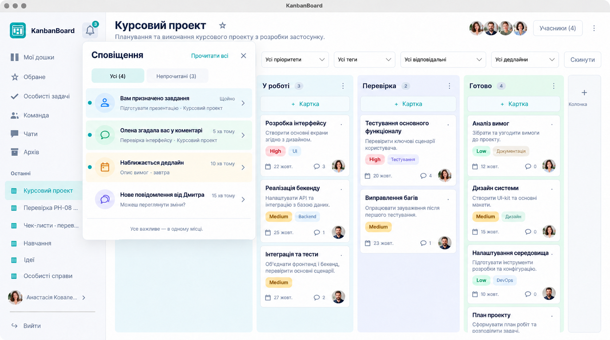
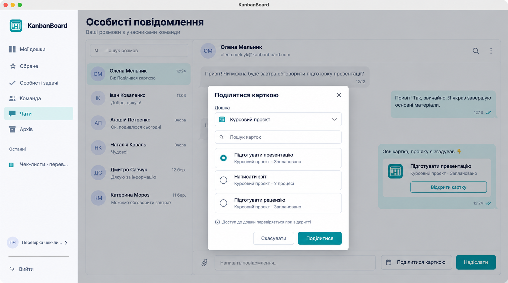

# Концепти сповіщень і карток у чаті — 19.10.2026

Макети центру сповіщень і надсилання картки в особистому чаті. Візуальні орієнтири — [дошка](../screenshots/ph08/04-board.png) та [дошка з чек-листами](../screenshots/checklists/02-board.png); компонування чату відповідає структурі `ChatView`. Фактичні результати роботи застосунку наведено у звітах про [сповіщення](../PH08_NOTIFICATIONS.md) та [картки в чаті](../PH08_CHAT_CARDS.md).

Центр містить глобальний дзвіночок, кількість непрочитаних, фільтр усіх/непрочитаних, дію «Прочитати всі» та події призначення, згадки, дедлайну й повідомлення. Перехід до картки або чату перевіряє доступ. Згадка — @email учасника з вибором із наявного списку; дедлайн — сьогодні/завтра для призначених користувачу карток. Лічильник відображає фактичні непрочитані повідомлення. Текст футера макета декоративний.

Кнопка «Поділитися карткою» відкриває вибір доступної дошки та картки. У переписці з’являється повідомлення з посиланням; картка відкривається лише за чинного доступу до дошки. Декоративні пошук розмов, скріпка та подвійні позначки на макеті не входять до обсягу функції.
