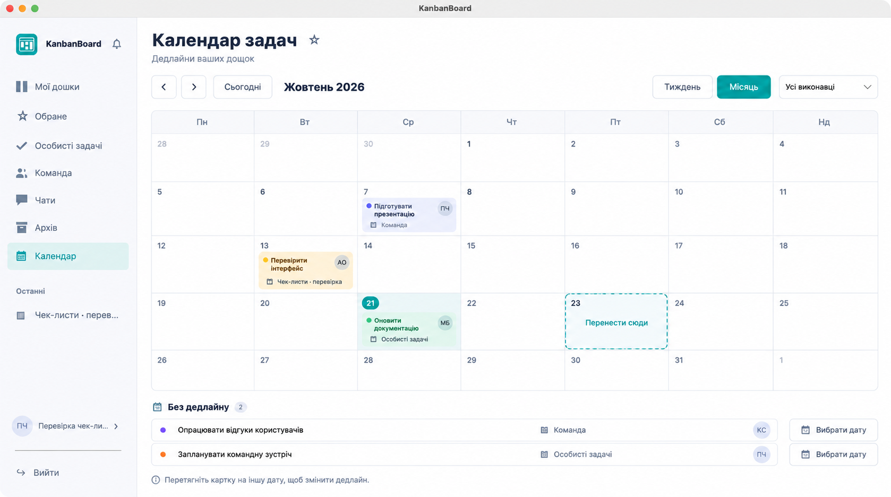

# Календар задач — концепт 21.10.2026

Макет календаря задач зі стилістикою [дошки з чек-листами](../screenshots/checklists/02-board.png). Концепт описує компонування; фактичні результати наведено у [звіті про календар](../PH08_CALENDAR.md).

Режими тижня й місяця, фільтр виконавця, відкриття картки та перенесення дедлайну перетягуванням. Понеділок — перший день; календар охоплює всі доступні активні дошки; задачі без дати мають окремий список. Дедлайн зберігається як дата без часу. Декоративна зірка в заголовку не позначає окремої функції. Кнопка вибору дати відкриває картку з наявним редактором дедлайну.
