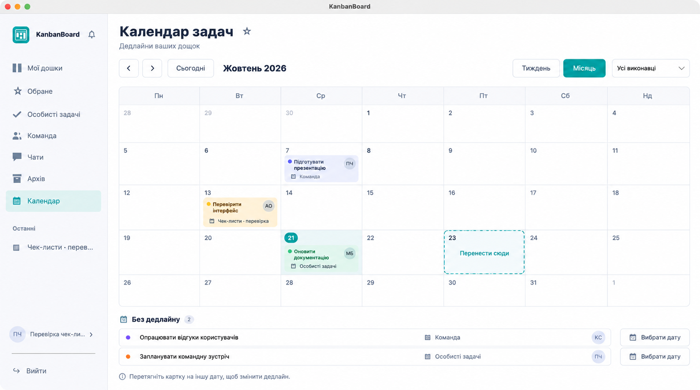

# Календар задач — концепт 21.10.2026

Концепт створено **до коду** вбудованим `image_gen` через навичку imagegen. Референс — справжній `screenshots/checklists/02-board.png`. Це згенерований макет, не доказ роботи інтерфейсу.

Погоджений обсяг: тиждень/місяць, фільтр виконавця, відкриття картки та перенесення дедлайну перетягуванням. Робочі рішення: понеділок — перший день; календар усіх доступних активних дощок; без дати — окремий список; тільки дата без часу. Декоративна зірка в заголовку не додає нову функцію. Кнопка вибору дати відкриває картку з наявним редактором дедлайну.

## Запит генерації (built-in)

Use case: ui-mockup. Generate one polished high fidelity native macOS Avalonia KanbanBoard task CALENDAR concept, using the supplied screenshot ONLY as existing design reference. Preserve exact logo direction, white panels, light blue gray sidebar, dark navy typography, restrained teal #168C98 controls, rounded subtle borders. Ukrainian interface. Sidebar existing Мої дошки, Обране, Особисті задачі, Команда, Чати, Архів, add selected Календар. Bell beside brand and profile/logout bottom. Main header Календар задач, subtitle Дедлайни ваших дощок. Toolbar left previous/next arrows, Сьогодні, heading Жовтень 2026; right two-state selector Тиждень / Місяць with Місяць active and assignee dropdown Усі виконавці. Large seven-column month grid starting Monday Пн Вт Ср Чт Пт Сб Нд, correct October 2026 calendar (October 1 is Thursday, 21 is Wednesday). Highlight day21 subtly. A few compact colored task tiles with title, board context and assignee initials: Підготувати презентацію, Перевірити інтерфейс, Оновити документацію. Each task clearly clickable. On October23 show subtle teal drop-target outline with Перенести сюди, suggesting drag rescheduling, without arrows or overlays. Bottom muted hint Перетягніть картку на іншу дату, щоб змінити дедлайн. Also small label Без дедлайну with two compact task rows below calendar, enabling dates for undated tasks. No unrelated features, no watermarks, no browser UI, no collage. This is a generated design concept, not a runtime screenshot.
