# PH-08 — фактичні екрани Avalonia

Дата: 16.10.2026. Це знімки справжнього нативного клієнта з Docker API і MSSQL. [Початкові ескізи](../../sketches/README.md), [матриця приймання](../../PH08_SCOPE.md), [підсумковий звіт](../../PH08_DESKTOP.md).

Фото й портрети вигаданих учасників — [демонстраційні матеріали](../../../assets/demo/README.md), завантажені звичайним API. Скриншоти не є згенерованими макетами. Вони фіксують різні моменти перевірки: тому лічильники, назви колонок і число учасників можуть відрізнятися. Основні перевірки виконані на окремій дошці «Перевірка PH-08 GUI».

## Мої дошки

Мої дошки — три стовпці, два ряди, фото, описи, ролі, аватари та лічильники.

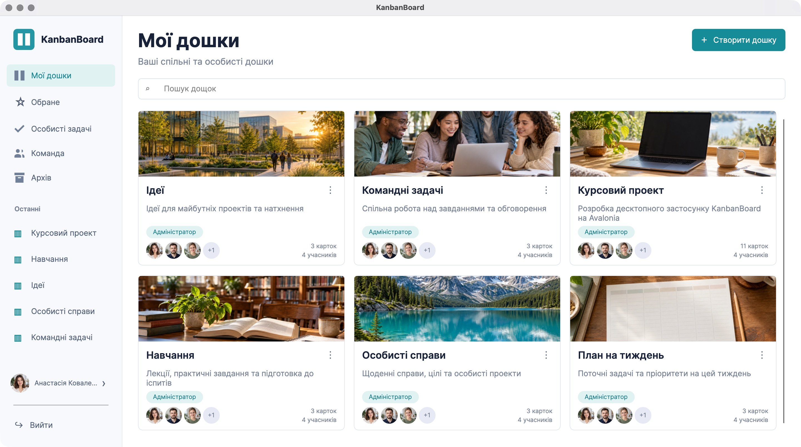

## Двоколонковий редактор

Двоколонковий редактор — обкладинка, опис, календар, пріоритет, відповідальний, теги й коментарі.

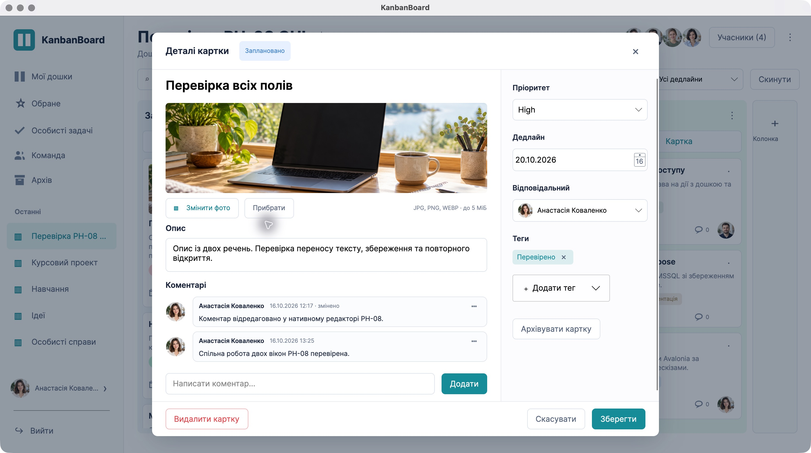

## Учасники

Учасники — захищений власник, додатковий адміністратор та окремі перемикачі дозволів.

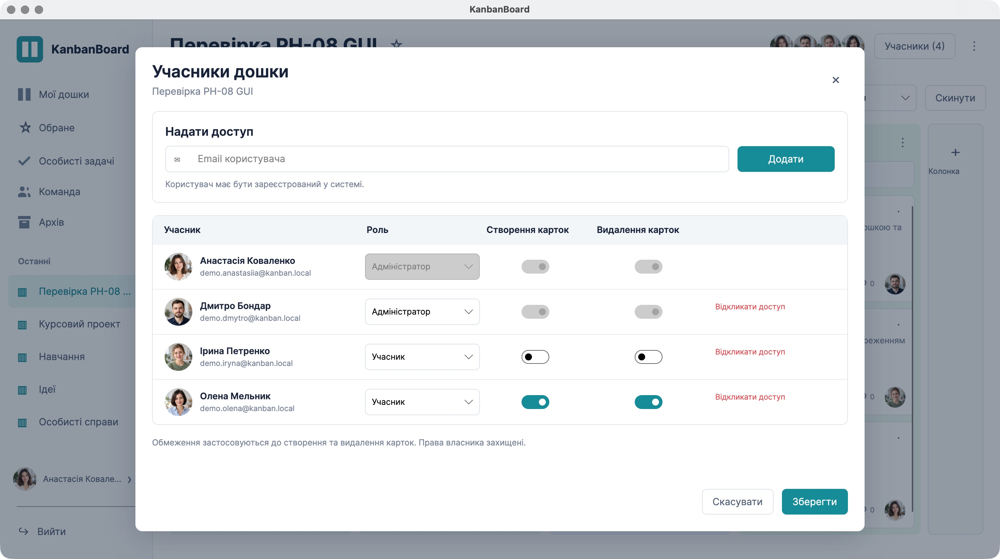

## Дошка

Дошка — чотири видимі колонки, картки з фото, описом, пріоритетом, тегом, датою, коментарями й аватаром.

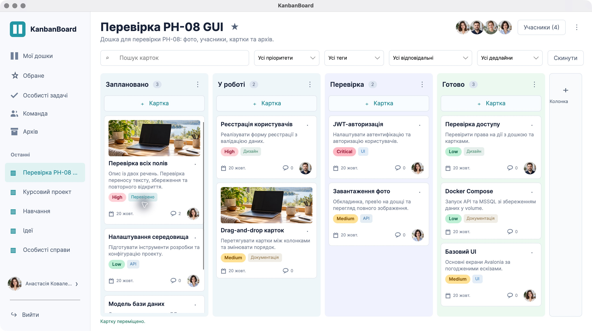

## Налаштування назви/опису, обкладинки, архівації та видалення дошки.

Налаштування назви/опису, обкладинки, архівації та видалення дошки.

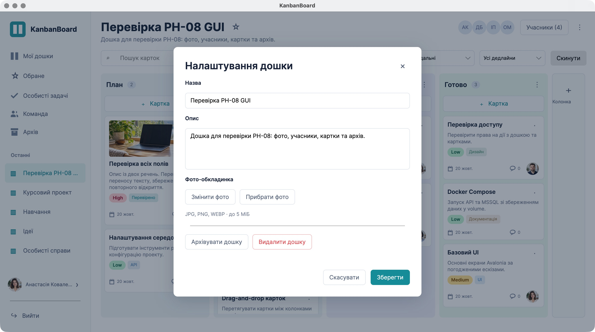

## Повне зображення поверх редактора.

Повне зображення поверх редактора.

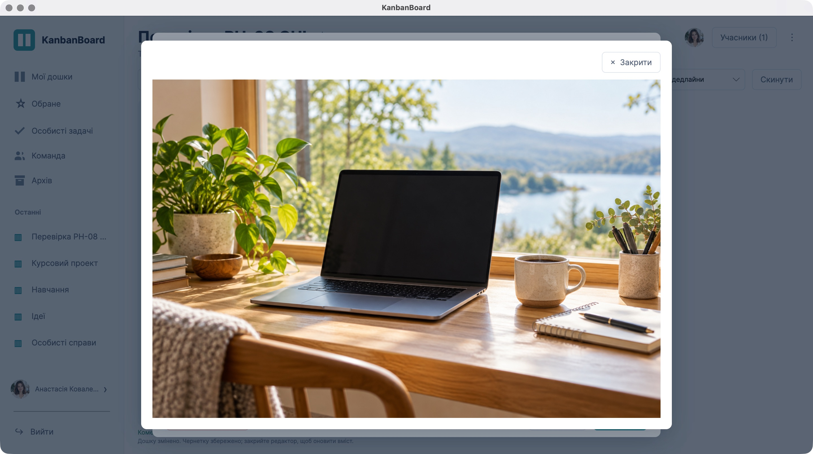

## Підтвердження закриття незбереженої чернетки

Підтвердження закриття незбереженої чернетки: повернутися до редагування або відкинути.

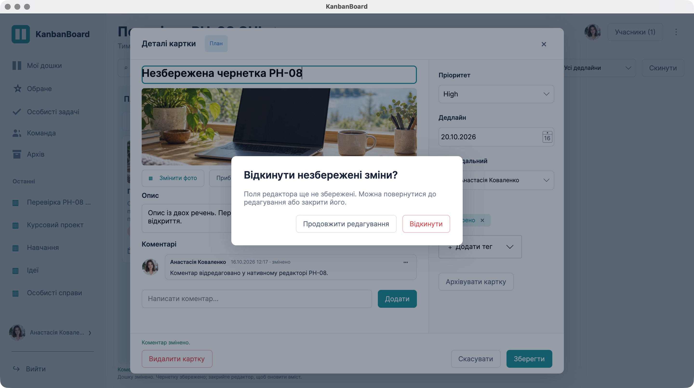

## Недоступний API

Недоступний API — повідомлення про помилку, картка повернута в початкову колонку.

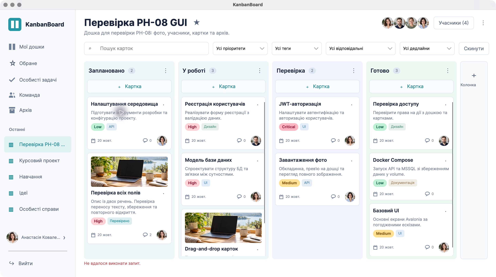

## Одночасно High + тег + відповідальний + майбутній дедлайн

Одночасно High + тег + відповідальний + майбутній дедлайн: лишається одна відповідна картка.

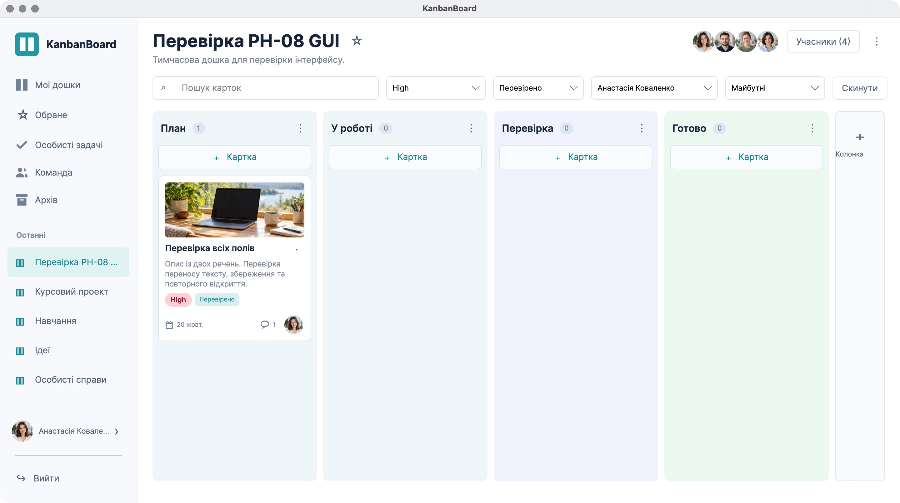

## Власний аккаунт

Власний аккаунт — усі поля й кнопки одночасно видимі в цільовому вікні.

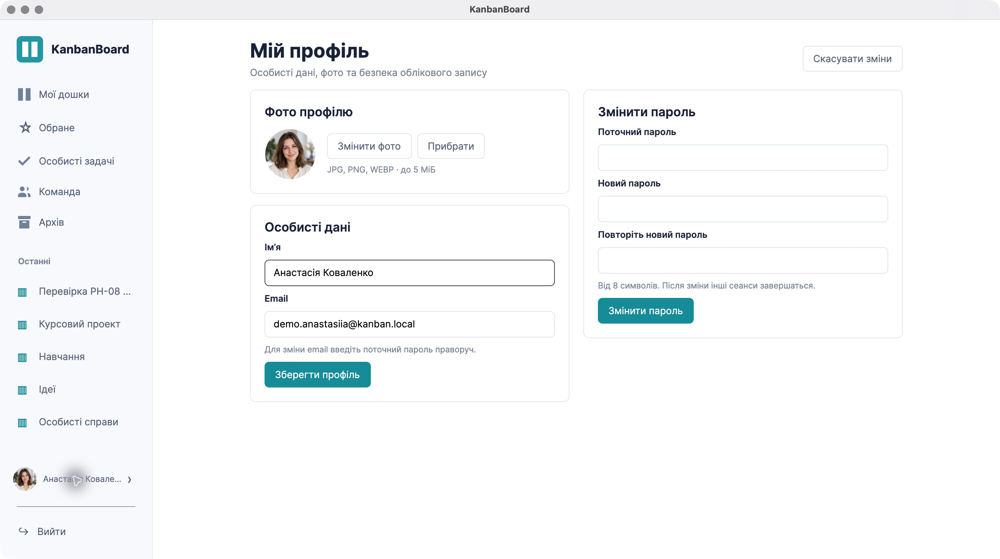

## Особисті задачі з усіх доступних дощок.

Особисті задачі з усіх доступних дощок.

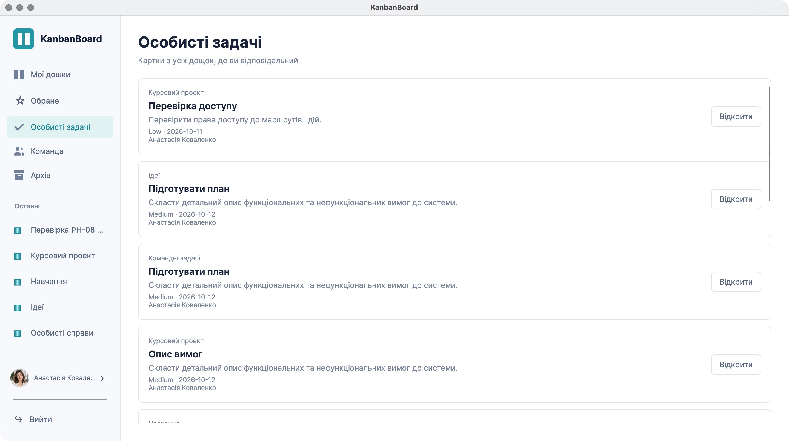

## Команда

Команда: поточні співучасники та захищені аватари.

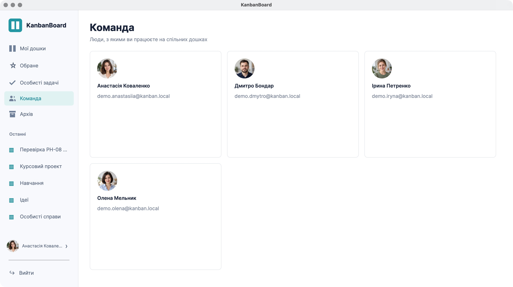

## Архів карток із робочим відновленням.

Архів карток із робочим відновленням.

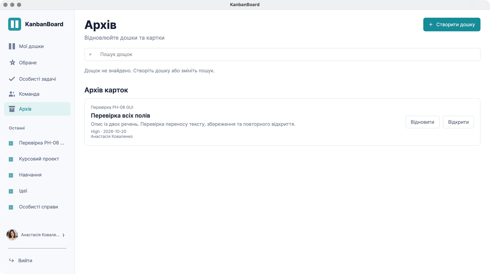

## Друге вікно Олени

Друге вікно Олени: коментарі власника отримані через API; власне меню редагування чужого коментаря відсутнє.

