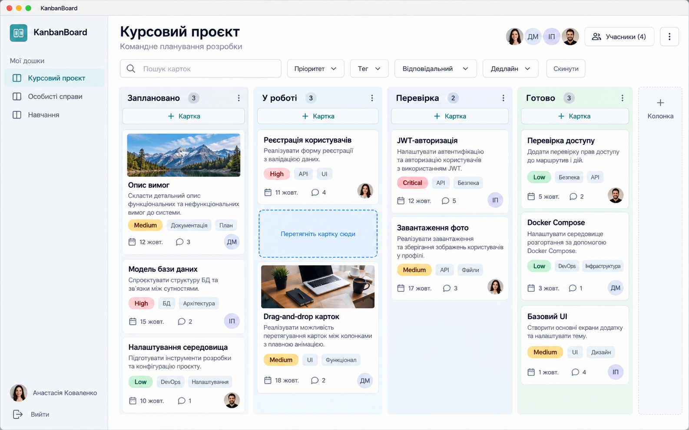
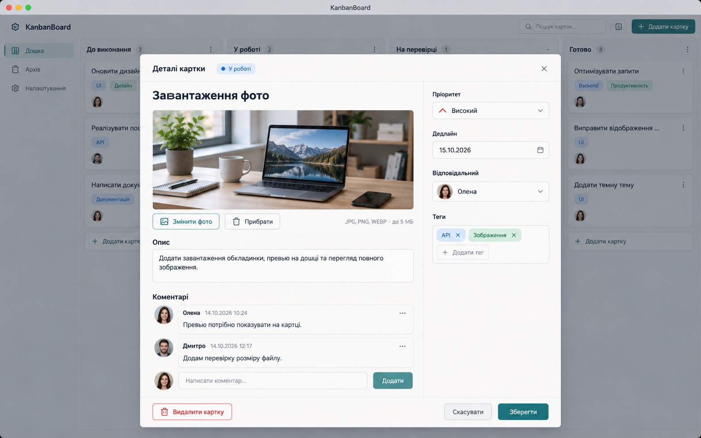
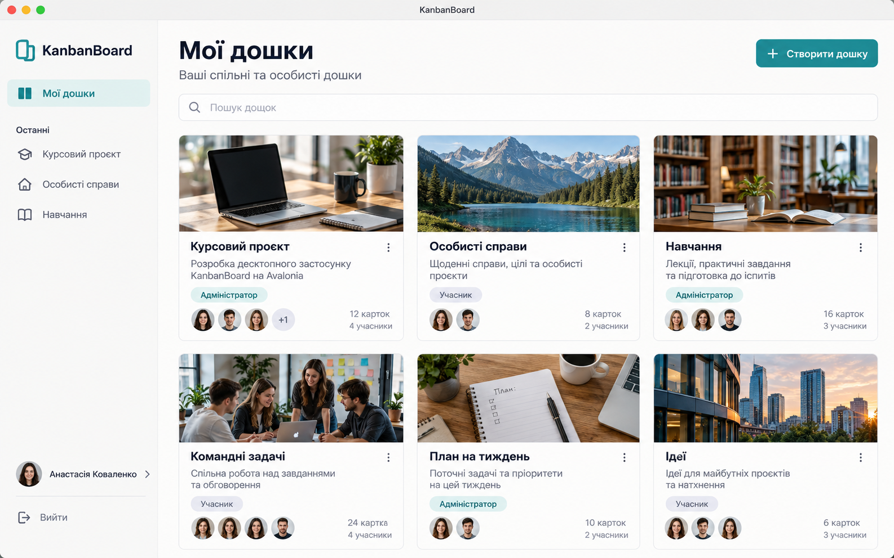
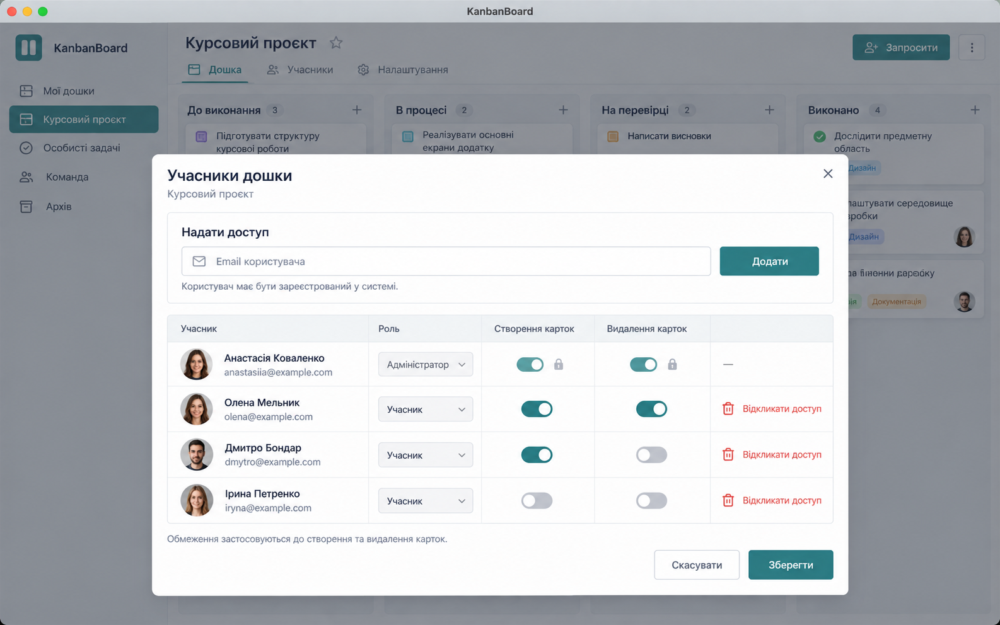

# Ескізи інтерфейсу KanbanBoard

Дата: 10.10.2026. Створено вбудованим інструментом imagegen.

Це концептуальні зображення інтерфейсу, а не скриншоти реалізованого застосунку. Написи, демонстраційні дані та окремі деталі генерації можна уточнити під час розробки.

## Головна дошка

## Деталі картки

## Використані описи генерації

### Головна дошка

Use case: ui-mockup. Asset type: generated raster design sketch for the KanbanBoard Avalonia desktop coursework application. Create one high-fidelity, polished, plausible desktop UI screenshot of the MAIN KANBAN BOARD, landscape 16:10, straight-on flat full-window view, no laptop, no browser chrome, no perspective. Visual style: calm contemporary light desktop interface, warm white canvas, slate typography, muted teal primary buttons, thin light gray borders, restrained corner rounding, readable sans-serif font. Native macOS title bar with small traffic-light controls and title KanbanBoard. All UI text in Ukrainian, with concise accurate labels. Slim left sidebar with KanbanBoard brand, «Мої дошки», selected board «Курсовий проєкт», two other boards, user avatar and «Вийти». Main header «Курсовий проєкт», description «Командне планування розробки», small participant avatars and «Учасники», overflow settings. Compact toolbar: search field «Пошук карток», filters «Пріоритет», «Тег», «Відповідальний», «Дедлайн», «Скинути». Main canvas contains FOUR fully visible horizontal Kanban columns titled «Заплановано», «У роботі», «Перевірка», «Готово», with count, three-dot menu and «+ Картка» controls. Each column contains 2–3 realistically sized cards, varied heights, generous spacing. Example card titles: «Реєстрація користувачів», «JWT-авторизація», «Модель бази даних», «Drag-and-drop карток», «Завантаження фото», «Перевірка доступу», «Docker Compose», «Опис вимог». Card contents show colored priority badge Low / Medium / High / Critical, small Ukrainian tags such as «API», «UI», «БД», due dates like «12 жовт.», assignee initials/avatar, small comment count. Two cards have tasteful photo covers, one modern desk workspace, one mountain landscape, integrated as wide thumbnails at top of card. Show one subtle drag-and-drop insertion indicator in «У роботі», without cursor clutter. Far right small «+ Колонка» affordance. Dense enough to demonstrate coursework features, uncluttered enough to implement in Avalonia. Crisp legible text and orderly alignment. No charts, no web navigation, no decorative slogans, no watermarks, no annotation callouts.

### Деталі картки

Use case: ui-mockup. Asset type: generated raster design sketch for the KanbanBoard Avalonia desktop coursework application. Create one high-fidelity, polished, plausible desktop UI screenshot focused on an OPEN CARD DETAILS WINDOW, landscape 16:10, straight-on flat full-window view, no laptop, no browser chrome, no perspective. Visual style: calm contemporary light desktop interface, warm white canvas, slate typography, muted teal primary buttons, thin light gray borders, restrained corner rounding, readable sans-serif font. Native macOS title bar with small traffic-light controls and title KanbanBoard. Ukrainian UI text with concise accurate labels. A subdued dimmed main kanban board is visible behind a large, sharply legible centered desktop dialog taking about 80 percent width. Dialog header «Деталі картки», subtle «У роботі» column indicator, close icon top right. The task title «Завантаження фото» is large and clear. Balanced TWO-column layout inside dialog: left column about 60 percent width, a landscape photo cover of a tidy modern desk workspace, attractive but not overpowering, controls «Змінити фото» and «Прибрати» underneath; below label «Опис» and an editable text area reading «Додати завантаження обкладинки, превью на дошці та перегляд повного зображення.» Right column about 40 percent: labeled fields «Пріоритет» with High selected, «Дедлайн» with «15.10.2026» and calendar icon, «Відповідальний» with avatar «Олена», «Теги» with pills «API» and «Зображення» plus add control. Small informational note next to upload «JPG, PNG, WEBP · до 5 МБ». Bottom part left shows «Коментарі», two well-designed comments with author avatar, Ukrainian author names «Олена», «Дмитро», date/time, short text such as «Превью потрібно показувати на картці.» and «Додам перевірку розміру файлу.», followed by input «Написати коментар…» and «Додати». Footer with understated red-outline «Видалити картку», neutral «Скасувати», teal primary «Зберегти». Show realistic editor state with all fields comfortably fitting, without page scrollbars or crowded text. Crisp legible Ukrainian labels, orderly alignment, plausible Avalonia desktop controls. No charts, no web navigation, no decorative slogans, no watermarks, no annotation callouts.

## Додаткові ескізи

### Мої дошки

### Учасники та права

Ролі в базовому плані відображаються як текст; можливість їх зміни, яку генератор показав як список, не входить до погодженого обсягу. Обкладинки дощок на ескізі — декоративна пропозиція дизайну, а не додаткова вимога до моделі даних.

## Описи генерації додаткових ескізів

Створено вбудованим інструментом imagegen.

### Мої дошки

Use case: ui-mockup. Asset type: generated raster design sketch for the KanbanBoard Avalonia desktop coursework application. Create one polished high-fidelity desktop UI screenshot of the MY BOARDS screen, landscape 16:10, straight-on flat full-window view. This belongs to a light KanbanBoard UI design series: warm white canvas, slate typography, muted teal primary buttons and selected navigation, thin pale gray borders, restrained rounding, highly legible sans-serif font. Native macOS title bar with traffic-light controls and title KanbanBoard. No browser chrome, laptop frame, perspective, watermark or explanatory callouts. Ukrainian interface. Narrow left sidebar shows KanbanBoard logo and name, selected «Мої дошки», a section «Останні» with «Курсовий проєкт», «Особисті справи», «Навчання», user avatar and name «Анастасія Коваленко», bottom «Вийти». Spacious main content header «Мої дошки», subtitle «Ваші спільні та особисті дошки», teal «+ Створити дошку» button on right. Under header compact search «Пошук дощок». Main body a tidy grid of SIX board tiles in two rows of three, generous spacing. Each tile has a tasteful horizontal photographic cover: modern laptop workspace, mountain lake, university library, team workspace, desk notebook, urban architecture respectively. Tile titles «Курсовий проєкт», «Особисті справи», «Навчання», «Командні задачі», «План на тиждень», «Ідеї». Tile details short relevant Ukrainian descriptions, small role badge «Адміністратор» or «Учасник», 2–4 circular participant avatars, small count text such as «12 карток», «4 учасники». Minimal three-dot action icon for administrator boards. Show native desktop controls and believable hierarchy; no dashboards, charts, analytics, web navigation or additional functionality outside a simple board list. All six tile covers and all tile content fully visible. Cohesive restrained design, practical to implement with Avalonia.

### Учасники та права

Use case: ui-mockup. Asset type: generated raster design sketch for the KanbanBoard Avalonia desktop coursework application. Create one polished high-fidelity desktop UI screenshot focused on an open BOARD MEMBERS AND PERMISSIONS dialog, landscape 16:10, straight-on flat full-window view. This belongs to a light KanbanBoard UI design series: warm white canvas, slate typography, muted teal primary buttons and selected navigation, thin pale gray borders, restrained rounding, highly legible sans-serif font. Native macOS title bar with traffic-light controls and title KanbanBoard. No browser chrome, laptop frame, perspective, watermark or explanatory callouts. Behind dialog show a softly dimmed Kanban board with sidebar and columns. Centered large crisp dialog about 75 percent window width, all content fully visible. Header «Учасники дошки», subtitle «Курсовий проєкт», close icon. Top invite section title «Надати доступ», email input with «Email користувача», teal «Додати» button, small helper «Користувач має бути зареєстрований у системі». Under it a clean four-row member permissions table with column headers «Учасник», «Роль», «Створення карток», «Видалення карток», and an action column. Each row has avatar, user name, muted example email. Rows: «Анастасія Коваленко» / anastasiia@example.com with role «Адміністратор», both permissions shown as enabled but locked; «Олена Мельник» / olena@example.com with role «Учасник», both teal switches enabled; «Дмитро Бондар» / dmytro@example.com with role «Учасник», creation enabled, deletion disabled; «Ірина Петренко» / iryna@example.com with role «Учасник», both switches disabled. Action on participant rows is understated red «Відкликати доступ» or red remove icon with short label, no self-removal action for administrator. Align headers and switches meticulously; clear ON and OFF states, generous readable rows. Lower explanatory line «Обмеження застосовуються до створення та видалення карток.» Footer neutral «Скасувати» and teal primary «Зберегти». Native desktop layout, calm functional aesthetic with no added analytics, chat features or unrelated controls. Accurate Ukrainian labels and orderly alignment.

