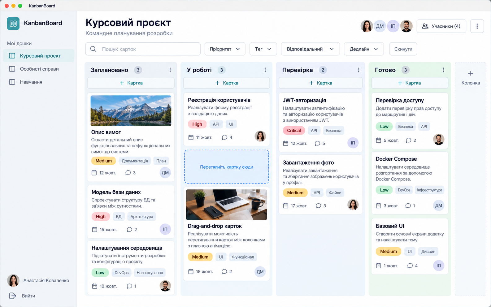
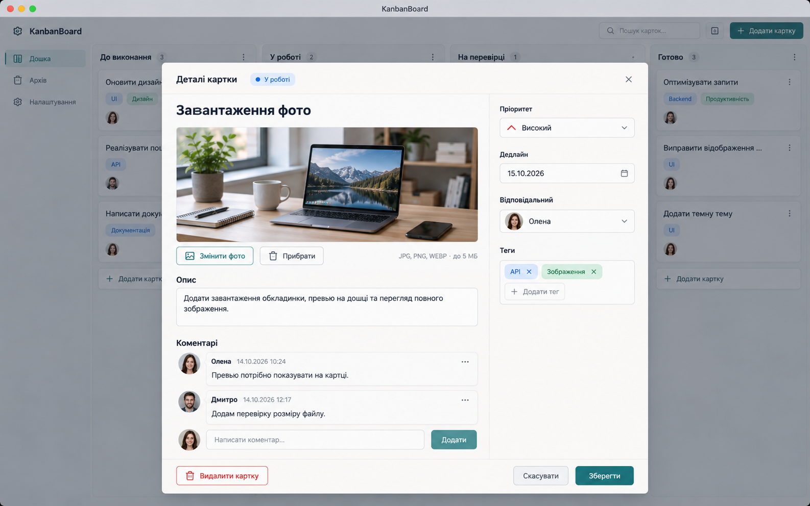
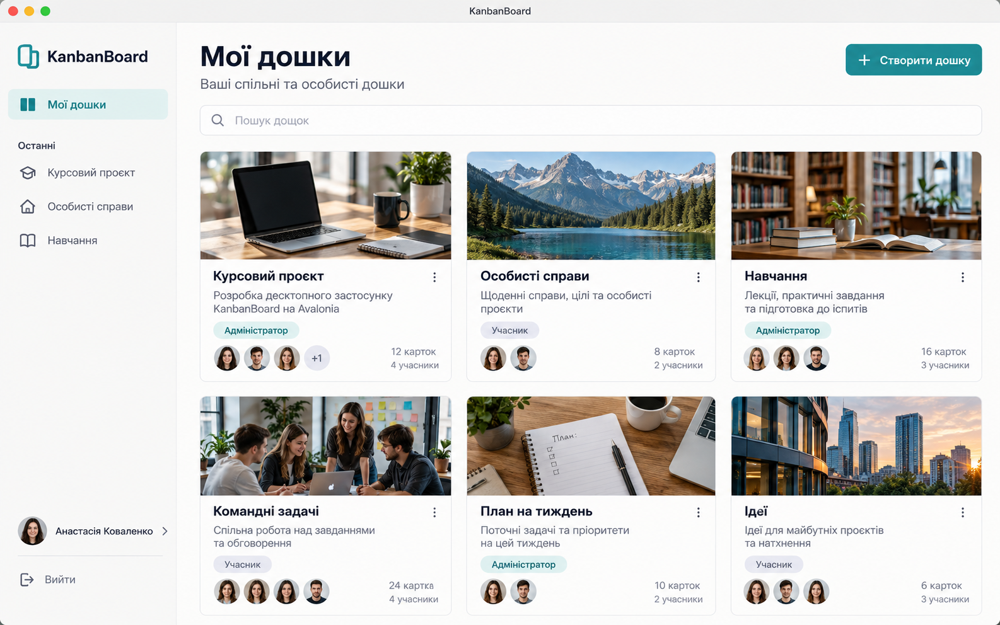
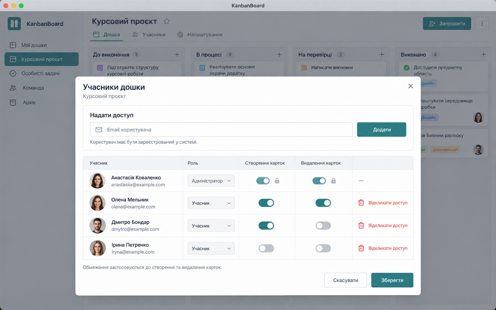

# Ескізи інтерфейсу KanbanBoard

Дата: 10.10.2026.

Концептуальні макети основних екранів. Демонстраційні дані й написи ілюструють структуру інтерфейсу; фактичний обсяг реалізації та критерії завершення наведено у [PH08_SCOPE](../PH08_SCOPE.md).

## Головна дошка

## Деталі картки

## Мої дошки

## Учасники та права

До PH-08 входять обкладинки дощок, зміна ролей, керування правами учасників і редактор власного профілю. Нативні екрани та результати перевірок зібрано у [звіті PH-08](../PH08_DESKTOP.md).
